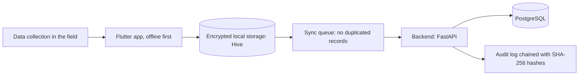

# Offline-first field data app for EUDR: case study

> **Private code.** The project is under a confidentiality agreement and its source code is not published. This repository is a case study: it describes the project at a high level, with no code, no screenshots and no internal details.

| | |
| --- | --- |
| **Client** | Coffee-sector client (confidential) |
| **Year** | 2026 |
| **Status** | Field pilot |

## Context

The EU Deforestation Regulation (EUDR) requires proof that coffee does not come from land deforested after 2020, and each farm's data is collected in rural areas with unreliable signal.

## My role

Development of the mobile app and of the backend it syncs with.

## Architecture

- The app works without a connection: a survey with conditional logic, the plot boundary walked with GPS, and consent capture.
- Data is stored encrypted on the device.
- A queue syncs to the backend without duplicating records.
- On the server, a tamper-evident audit log is chained with SHA-256 hashes.

## Key features

- Conditional survey logic
- GPS plot boundary
- On-device encryption
- Duplicate-free offline sync
- Hash-chained audit log

## Stack

Flutter · Dart · Hive · Python · FastAPI · PostgreSQL

## Results

In a field pilot, with a tamper-evident audit log hash-chained with SHA-256 on the server.
